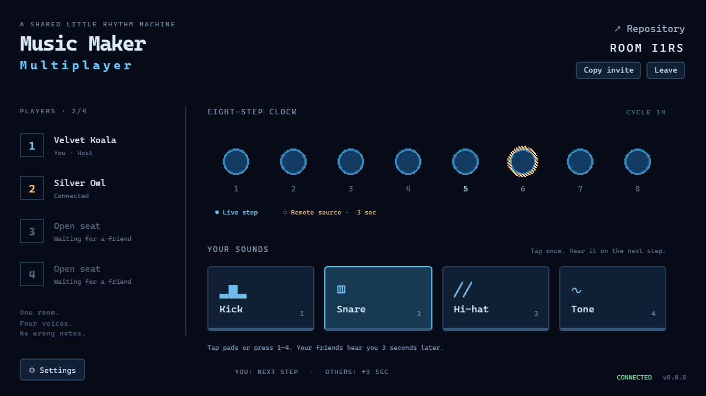

# Music Maker Multiplayer

A tiny shared rhythm machine for **1–4 players**. Eight blue steps, four sounds, and an endlessly repeating clock.

[Live demo](https://samuelasherrivello.github.io/babylon-lite-music-maker-multiplayer/) · [Multiplayer server](https://github.com/SamuelAsherRivello/rmc-colyseus-multiplayer-server) · [Build brief and UI sketch](openspec/changes/add-multiplayer-pixel-music-sandbox/prompt.md)

The demo is being verified for initial publication; deployment status is recorded in [implementation evidence](docs/music-implementation.md).



## Play

Create a room, then copy its invite or share the four-character code. The server assigns each player a number, fictional name and color. The host can play alone; friends can join the running clock.

Click/tap **Kick, Snare, Hi-hat, Tone**, or press **1–4**. Each tap plays once on the next half-second step. Repeated taps of one pad before that step collapse into one sound; different pads combine. These are one-shots, not a recorded repeating pattern. Eight steps take four seconds.

You hear your own sound on the next step. Everyone else hears it **exactly three seconds after that source deadline**, including the host listening to guests. The blue cursor shows the shared live step; the dotted amber marker shows the remote source six steps behind it. The remote buffer fills for the first three seconds.

Invite links join automatically. Select **Enable sound** when needed for browser autoplay. Settings provides local mute and fullscreen. `?mute=true` silences all sound for testing. Leaving or losing the host ends the jam; create a new room to play again. Guests can rejoin with a fresh identity while the host is connected.

## Run locally

Use Node.js 24 and npm:

```sh
npm ci
npm run dev -- --host 127.0.0.1
npm test
npm run build
npm run preview
```

Open the URL Vite prints, under `/babylon-lite-music-maker-multiplayer/`. The application root is `music-maker/`; run commands from the repository root. Production uses the public Vercel relay. For a local backend, copy `.env.example` to `.env.local` and start the shared server separately. No credentials belong in the browser configuration.

## Browser and hosting

Use a current WebGPU-capable browser/device, such as accelerated Edge or Chrome. The original pixel scene uses Babylon Lite, a fixed 640×360 raster, a fixed camera and nearest-neighbor scaling. Landscape is intended; portrait devices show a rotation hint. Integer display scales preserve uniform pixel sizes; fractional fits may have uneven physical pixel widths. Unsupported WebGPU displays an explicit message.

The backend runs on **Vercel's free Hobby plan**, at [the dedicated Music endpoint](https://rmc-music-maker.vercel.app/api/health). The host owns music simulation; the server is a private-room relay. Planned connection renewal before the free plan's five-minute limit retains the host's clock and buffered event deadlines. Unexpected host loss ends the session. See [hosting behavior and limits](docs/hosting.md). Browser suspension, free quota exhaustion, deployment or cross-instance routing can interrupt a jam. No durable account, saved music, host migration or unlimited hosting guarantee is claimed.

## Original AI Prompt

Original conversation URL: **unverified; not supplied**. [Preserved request excerpt and labeled follow-ups](docs/original-request.md).

<details>
<summary>Original abstract game request (verbatim excerpt)</summary>

```text
So it's an abstract idea, and I want the first version of it to be complete but very simple. The idea is that up to four players can join. There's a player list on the side that has their number and their randomly generated name, which the multiplayer server does. And then there's a timeline horizontally down the middle of the screen that has four circles. And to a certain beat, like every... every one second. No, let's make it eight. And every half a second, one of them pulses in shape, gets a little larger temporarily. The color goes from blue to bright blue, and you play a little beep, like beep, beep, beep, a little beep noise. And the idea is that either player can... they each have four buttons in front of them, not the ones I mentioned, but other ones, and they can press them, and no matter when they press them, you play the sound for both players on the next full beat.
```

Consequential follow-up, verbatim:

```text
we use only a relay server so the host simulates for all

No if the local player taps the sound it always plays on the very next 8th. but the REMOTE people hear it on that same beat but 3 seconds later.

you are required to use the free plan of vercel. stop asking for alternatives
```

The initiating message used a dungeon-game template as a starting structure. The selected game is the clarified music sandbox; dungeon mechanics and reference assets were discarded. Interview interpretations and implementation choices are labeled separately in the linked brief.

</details>

## Credits and development

Original procedural pixel atlas, interface and synthesized kick/snare/hi-hat/tone/metronome sounds were created for this project. No external game artwork, sampled music or fonts are required. Uses [Babylon Lite](https://github.com/BabylonJS/Babylon-Lite), React and Vite; dependency licenses remain with their authors.

Created through [GitHub Repository Template](https://github.com/SamuelAsherRivello/github-repository-template), with ordinary files imported from [AI Skills Library](https://github.com/SamuelAsherRivello/ai-skills-library). Source revisions, tooling and verification evidence are recorded in [music-implementation.md](docs/music-implementation.md). The backend/shared-client [v0.9.13 release](https://github.com/SamuelAsherRivello/rmc-colyseus-multiplayer-server/releases/tag/v0.9.13) is pinned by its exact tarball URL and integrity in package.json and package-lock.json.

GitHub Actions `release.yml` bumps `version.txt` and publishes the tag. `deploy-pages.yml` tests, builds and deploys the game to Pages. Release-generated commits are synchronized back to the local checkout.
